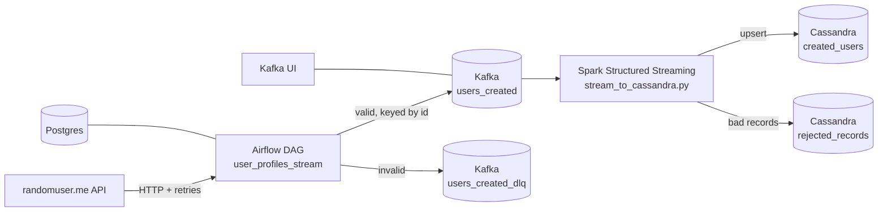

# Real-Time Data Streaming Pipeline

[](https://github.com/omoissy/realtime-data-streaming-pipeline/actions/workflows/ci.yml)

**Airflow · Kafka (KRaft) · Spark Structured Streaming · Cassandra · Docker Compose**

An end-to-end streaming pipeline that runs in containers. An Airflow DAG pulls live user profiles from the
[randomuser.me](https://randomuser.me) API and publishes them to Kafka. A Spark Structured Streaming job
validates the stream and upserts it into Cassandra.



## What makes it robust

| Layer | Safeguard |
|---|---|
| Ingestion | The HTTP client retries 429 and 5xx responses with exponential backoff and honors `Retry-After`. The run fails after N consecutive API failures. |
| Validation | Each record is checked for a UUID, a valid email and the required fields before it is published. Invalid records go to a **dead-letter topic** with the reason attached. |
| Kafka producer | Idempotent producer (`enable.idempotence`, `acks=all`). Messages are keyed by user id, so a user always lands on the same partition. Every delivery is tracked, and the task fails if any message is undelivered. |
| Orchestration | Task retries with exponential backoff, `max_active_runs=1`, execution timeouts, runtime params (`duration_seconds`, `batch_size`). A **quality gate** task fails the run if nothing was produced or too many records were rejected. |
| Kafka | KRaft mode (no ZooKeeper). Topics are created explicitly at startup and auto-creation is turned off. Data is stored on a persistent volume. |
| Spark | Explicit schema. Malformed JSON is captured through `_corrupt_record`. Checkpointing gives restart-from-offset recovery. `maxOffsetsPerTrigger` provides backpressure. A query-progress listener logs throughput. |
| Cassandra | Writes are upserts on `id`, so replayed micro-batches are **idempotent**. Rejected messages are stored with their Kafka partition and offset so you can trace them. |
| Containers | Every service has a healthcheck, and `depends_on` waits on health or on init jobs completing. Connector JARs are baked into the Spark image, so nothing is downloaded from Maven at runtime. |

## Quick start

Requires Docker Desktop (or another Docker engine with Compose v2) with about 6 GB of RAM allocated.

```bash
docker compose up -d --build      # start everything
docker compose ps                 # wait until services are healthy
```

| UI | URL |
|---|---|
| Airflow (login `airflow` / `airflow`) | http://localhost:8080 |
| Kafka UI | http://localhost:8085 |
| Spark master | http://localhost:9090 |
| Spark streaming job | http://localhost:4040 |

Unpause and trigger the `user_profiles_stream` DAG in Airflow. Then check the data in Cassandra:

```bash
docker compose exec cassandra cqlsh -e \
  "SELECT id, first_name, last_name, email, nationality FROM spark_streams.created_users LIMIT 10;"
```

Stop the stack with `docker compose down`, or use `docker compose down -v` to delete all data.

## Testing

```bash
make install   # producer package + pytest, ruff, pyspark (needs Java 17 for the Spark tests)
make check     # ruff + unit tests
make compose-up && make e2e   # full stack: trigger the DAG, require rows in Cassandra
```

The unit tests cover API retries and payload checks, record validation, dead-letter routing,
delivery-failure handling, and the Spark parsing logic. Contract tests keep three things in
sync: the producer's message fields, the Spark schema, and the Cassandra table columns.

GitHub Actions runs the unit tests on every push. It then builds and starts all 12 containers,
triggers the DAG through the Airflow REST API, waits for the run to succeed, and checks that
rows arrive in Cassandra.

## Project layout

```
airflow/            Airflow image (adds confluent-kafka)
dags/               user_profiles_stream DAG
src/user_stream/    producer package: API client, validation, Kafka producer
spark/              Spark image (Kafka + Cassandra connectors) and the streaming job
cassandra/          keyspace and table definitions
scripts/e2e.sh      end-to-end check against the running stack
tests/              unit and contract tests
docker-compose.yml  the full stack (12 services)
```

You can also run the producer from your machine, outside Airflow:
`PYTHONPATH=src python -m user_stream --bootstrap localhost:9092 --duration 30`
