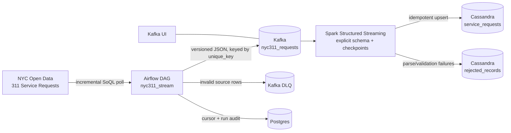

# NYC 311 Real-Time Data Streaming Pipeline

[](https://github.com/omoissy/nyc311-streaming-pipeline/actions/workflows/ci.yml)

**Airflow · Kafka (KRaft) · Spark Structured Streaming · Cassandra · Postgres · Docker Compose**

An end-to-end pipeline for real NYC 311 service-request data. Airflow polls the official NYC Open Data Socrata API for new requests, publishes versioned events to Kafka, Spark validates and parses the stream, and Cassandra stores queryable request records. Postgres keeps the incremental source cursor and ingestion audit; Kafka UI, Spark UI, and Airflow expose operational state.

The source dataset is [NYC 311 Service Requests from 2020 to Present](https://data.cityofnewyork.us/Social-Services/311-Service-Requests/erm2-nwe9). NYC Open Data says the dataset is updated daily, includes request type, responding agency, status, and location, and does not expose the customer’s personally identifying information.



## Why it is robust

| Layer | Safeguard |
|---|---|
| Source | Official API, bounded SoQL queries, request timeouts, retries for 429/5xx responses, and `Retry-After` support. |
| Incremental ingestion | Postgres stores `(created_date, unique_key)` as a durable cursor and records every ingestion run. A replay is safe because downstream writes use the NYC request key. |
| Validation | Required fields, timestamps, and coordinates are normalized before publishing. Invalid rows go to a dead-letter topic with the original payload and reason. |
| Kafka | KRaft mode, explicit topic creation, auto-creation disabled, idempotent producer, `acks=all`, keyed messages, and delivery tracking. |
| Spark | Explicit schema, corrupt JSON capture, typed timestamps and coordinates, per-batch persistence, checkpoint recovery, offset backpressure, and `failOnDataLoss=true`. |
| Cassandra | `unique_key` is the primary key, so replayed micro-batches upsert the same service request instead of duplicating it. Rejected rows retain Kafka coordinates for diagnosis. |
| Operations | Airflow retries with exponential backoff, a quality gate, healthchecks, persistent volumes, Kafka UI, Spark UI, and a full Compose smoke test in GitHub Actions. |

## Quick start

Requires Docker Desktop or another Docker Engine with Compose v2 and approximately 6 GB of RAM.

```bash
docker compose up -d --build
docker compose ps
```

The scheduled DAG is paused by default. Open Airflow at http://localhost:8080, unpause `nyc311_stream`, and trigger it. Or run the end-to-end check:

```bash
make e2e
```

The e2e check waits for the stack, triggers an Airflow run for recent NYC 311 records, waits for the run to succeed, and verifies rows in Cassandra.

| Service | URL |
|---|---|
| Airflow (`airflow` / `airflow`) | http://localhost:8080 |
| Kafka UI | http://localhost:8085 |
| Spark master | http://localhost:9090 |
| Spark streaming query | http://localhost:4040 |

Inspect stored events:

```bash
docker compose exec cassandra cqlsh -e \
  "SELECT unique_key, complaint_type, agency, borough, status FROM nyc311_streams.service_requests LIMIT 10;"
```

Inspect the ingestion cursor and run audit in Postgres:

```bash
docker compose exec postgres psql -U airflow -d airflow -c \
  "SELECT * FROM pipeline.ingestion_runs ORDER BY finished_at DESC LIMIT 5;"
```

Stop the stack with `docker compose down`. Use `docker compose down -v` to remove local state and force a fresh source lookback on the next run.

## Testing

```bash
make install   # package plus pytest, ruff, and PySpark
make check     # lint plus all unit and contract tests
make compose-up
make e2e
make compose-down
```

The tests cover Socrata response handling, cursor ordering, timestamp and coordinate validation, DLQ behavior, delivery failures, Postgres state boundaries, Kafka/Spark/Cassandra schema alignment, malformed messages, and no-record-loss partitioning between valid and rejected outputs.

GitHub Actions runs lint and tests, then builds the complete 12-service Docker Compose stack and executes the end-to-end check.

## Project layout

```text
airflow/                 Airflow image and Kafka/Postgres client dependencies
dags/                    nyc311_stream Airflow DAG
src/nyc311_stream/       API client, cursor store, validation, Kafka producer
spark/app/               Spark Structured Streaming parser and Cassandra writer
cassandra/               keyspace and table definitions
scripts/e2e.sh           end-to-end check against the running stack
tests/                   unit, Spark, Cassandra-contract, and fixture tests
docker-compose.yml       complete local stack
```

Run one ingestion batch outside Airflow after the stack is up:

```bash
PYTHONPATH=src python -m nyc311_stream --bootstrap localhost:9092 --max-records 100
```

## Data and privacy

This project stores service-request metadata needed for operational analysis. It does not ingest customer names, phone numbers, or email addresses. Exact incident locations from the public dataset should be handled according to the NYC Open Data terms and can be removed or generalized before wider publication.
