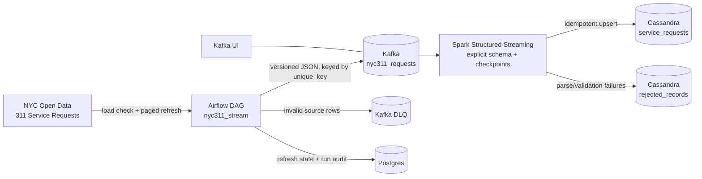

# NYC 311 Real-Time Data Streaming Pipeline

[](https://github.com/omoissy/nyc311-streaming-pipeline/actions/workflows/ci.yml)

**Airflow · Kafka (KRaft) · Spark Structured Streaming · Cassandra · Postgres · Docker Compose**

An end-to-end pipeline for real NYC 311 service-request data. Airflow checks the official NYC Open Data Socrata API for each new daily load and refreshes recent requests (new requests, late arrivals, and status or closure changes), publishes versioned events to Kafka, Spark validates and parses the stream, and Cassandra stores the latest version of each request. Postgres keeps the refresh progress and an audit row for every run; Kafka UI, Spark UI, and Airflow expose operational state.

The source dataset is [NYC 311 Service Requests from 2020 to Present](https://data.cityofnewyork.us/Social-Services/311-Service-Requests/erm2-nwe9). NYC Open Data says the dataset is updated daily, includes request type, responding agency, status, and location, and does not expose the customer’s personally identifying information.



## Why it is robust

| Layer | Safeguard |
|---|---|
| Source | Official API, bounded SoQL queries, request timeouts, retries for 429/5xx responses, and `Retry-After` support. |
| Change capture | NYC publishes in daily bulk loads. Each hourly run reads the dataset's `rowsUpdatedAt`; without a new load it is a no-op. After a load it re-reads every request created in the last `REFRESH_WINDOW_DAYS` (default 7; about 60,000 rows in November 2026), keyset-paged on `(created_date, unique_key)`, so closures and late-published requests are captured. Changes to requests older than the window are not. The API cannot sort the dataset by `:updated_at`, which rules out a pure change cursor. |
| Incremental state | Postgres stores the refresh position, which is saved only after Kafka acknowledges every message. A refresh that hits `MAX_RECORDS_PER_RUN` resumes on the next run. Every run, including failures, gets an audit row. Replays are safe because Cassandra upserts on `unique_key`, and Spark keeps only the newest version of a request within each micro-batch. |
| Validation | Required fields, timestamps, and coordinates are normalized before publishing. Source timestamps are NYC wall-clock time with no zone; they are converted to UTC (handling daylight saving time) and SoQL queries use zone-less literals, which is what Socrata accepts. Invalid rows go to a dead-letter topic with the original payload and reason. |
| Kafka | KRaft mode, explicit topic creation, auto-creation disabled, idempotent producer, `acks=all`, keyed messages, and delivery tracking. |
| Spark | Explicit schema, corrupt JSON capture, typed timestamps and coordinates, per-batch persistence, checkpoint recovery, offset backpressure, and `failOnDataLoss=true` (fail loudly rather than skip offsets). |
| Cassandra | `unique_key` is the primary key, so replayed micro-batches upsert the same service request instead of duplicating it. Rejected rows retain Kafka coordinates for diagnosis. |
| Operations | Airflow retries with exponential backoff, a quality gate, healthchecks, persistent volumes, Kafka UI, Spark UI, and a full Compose smoke test in GitHub Actions. |

## Quick start

Requires Docker Desktop or another Docker Engine with Compose v2 and approximately 6 GB of RAM.

```bash
docker compose up -d --build
docker compose ps
```

The scheduled DAG is paused by default. Open Airflow at http://localhost:8080, unpause `nyc311_stream`, and trigger it. Or run the end-to-end check:

```bash
make e2e
```

The e2e check waits for the stack, triggers an Airflow run for recent NYC 311 records, waits for the run to succeed, and verifies rows in Cassandra.

| Service | URL |
|---|---|
| Airflow (`airflow` / `airflow`) | http://localhost:8080 |
| Kafka UI | http://localhost:8085 |
| Spark master | http://localhost:9090 |
| Spark streaming query | http://localhost:4040 |
| Operations dashboard | http://localhost:8501 |

Inspect stored events:

```bash
docker compose exec cassandra cqlsh -e \
  "SELECT unique_key, complaint_type, agency, borough, status FROM nyc311_streams.service_requests LIMIT 10;"
```

Inspect the refresh state and run audit in Postgres:

```bash
docker compose exec postgres psql -U airflow -d airflow -c "SELECT * FROM pipeline.refresh_state;"
docker compose exec postgres psql -U airflow -d airflow -c \
  "SELECT status, pages, fetched, produced, dead_lettered, refresh_complete, error
   FROM pipeline.ingestion_runs ORDER BY finished_at DESC LIMIT 5;"
```

Set `NYC311_APP_TOKEN` (a free Socrata app token) for a higher API rate limit.

### Operations dashboard

http://localhost:8501 is a Streamlit dashboard over the same stack. It shows:

- **Pipeline health:** Airflow, Kafka topics, the Spark master and the streaming job.
- **Charts:** requests per hour (New York time, with recent still-filling hours shaded), the top complaint types, the median time to close per complaint type (with the middle 50% of closures), current status, and borough. Bar labels show each category's share of all requests.
- **Lineage:** the Postgres refresh state, recent ingestion runs (including failures), Kafka topic sizes, and the reasons Spark rejected records.

Charts read every stored request (up to `DASHBOARD_MAX_ROWS`, default 300,000) and warn if that cap cuts the read short. Closure times only count closed requests, so slow-closing types read short; the caption says so.

Stop the stack with `docker compose down`. Use `docker compose down -v` to remove local state and force a full refresh of the window on the next run.

## Testing

```bash
make install   # package plus pytest, ruff, and PySpark
make check     # lint plus all unit and contract tests
make compose-up
make e2e
make compose-down
```

`RUN_LIVE_TESTS=1 python -m pytest tests/test_live_api.py` runs two opt-in checks against the real NYC API, confirming Socrata accepts the queries the client builds.

The tests cover the dashboard's data preparation (New York time, shares, closure-time statistics, data-quality counts), Socrata response handling, query literal format, NYC time-zone conversion across daylight saving time, keyset paging and resume, no-op runs without a new load, failed-run auditing, newest-version-wins deduplication, cursor ordering, timestamp and coordinate validation, DLQ behavior, delivery failures, Postgres state boundaries, Kafka/Spark/Cassandra schema alignment, malformed messages, and no-record-loss partitioning between valid and rejected outputs.

GitHub Actions runs lint and tests, then builds the complete 13-service Docker Compose stack and executes the end-to-end check.

## Project layout

```text
airflow/                 Airflow image and Kafka/Postgres client dependencies
dags/                    nyc311_stream Airflow DAG
src/nyc311_stream/       API client, cursor store, validation, Kafka producer
spark/app/               Spark Structured Streaming parser and Cassandra writer
cassandra/               keyspace and table definitions
scripts/e2e.sh           end-to-end check against the running stack
dashboard/               Streamlit operations dashboard and easy-viz charts
tests/                   unit, Spark, Cassandra-contract, and fixture tests
docker-compose.yml       complete local stack
```

Run one ingestion batch outside Airflow after the stack is up:

```bash
PYTHONPATH=src python -m nyc311_stream --bootstrap localhost:9092 --max-records 100
```

## Data and privacy

This project stores service-request metadata needed for operational analysis. It does not ingest customer names, phone numbers, or email addresses. Exact incident locations from the public dataset should be handled according to the NYC Open Data terms and can be removed or generalized before wider publication.
